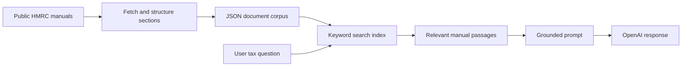

# HMRC Tax RAG Assistant

> A source-grounded retrieval-augmented generation (RAG) prototype for answering questions from publicly available HMRC tax manuals, combining keyword retrieval with an LLM.

**Status:** Implemented retrieval and response-generation workflow with a prepared manual corpus. Formal retrieval/answer evaluation and user-visible citations remain to be developed.  
**Tools:** Python, OpenAI API, minsearch, SQLite search experiments, GOV.UK APIs, uv and Jupyter.

## Executive Summary

Tax guidance is complex and changes over time. A general language model may produce plausible but unsupported answers, especially when asked about detailed legislation or HMRC operational guidance. This project investigates a retrieval-augmented workflow that first finds relevant passages in published HMRC manuals and then prompts a model to respond using the retrieved context.

The result is a technical research prototype, **not a validated tax advisory service**. Retrieved source text improves traceability but does not guarantee factual or legal correctness.

## Problem and Objectives

1. Collect structured sections from selected public HMRC manuals.
2. Create searchable indexes containing titles, passages and source URLs.
3. Retrieve relevant passages for a question.
4. Build a grounded prompt and generate an answer from those passages.
5. Evaluate retrieval relevance, response correctness and abstention on unsupported questions.
6. Expose clear, checkable citations in a future user-facing interface.

## Data Sources

The repository includes `data/docs.json`, a stored extract of **1,299 sections** from five HMRC manuals, as documented in the original project.

| Manual | Subject |
| --- | --- |
| `company-taxation-manual` | Corporation tax |
| `vat-registration-manual` | VAT registration |
| `paye-manual` | PAYE |
| `capital-gains-manual` | Capital gains tax |
| `capital-allowances-manual` | Capital allowances |

Records contain a manual identifier, section ID, title, text and original GOV.UK URL. Tax documentation is subject to updates and the local dataset is a snapshot, not a live guarantee of current guidance.

## Architecture



## Technical Implementation

### 1. Retrieval corpus

`src/scrape_manuals.py` collects manual content and writes structured documents. `src/load_index.py` loads the stored JSON file and constructs an in-memory `minsearch` index using section titles and text, with the manual type as a filterable field.

### 2. Grounded responses

`src/tax_knowledge_agent.py` defines `TaxKnowledgeAgent`. Its `search()` method retrieves matching sections, `build_context()` assembles passages and source URLs, and `rag()` passes the assembled context to the configured OpenAI client.

**Current scope restriction:** The agent defaults to `manual="company-taxation-manual"`. Although five manuals are stored, the default agent searches only the corporation tax manual unless its configuration is changed.

### 3. Source traceability

Retrieved document URLs are included in the **prompt context**. The code currently returns the model's answer text directly; it does not implement a separately validated output citation system. Claims that every answer visibly cites a source or is automatically correct would therefore be premature.

### 4. Notebook experiments

The two research notebooks cover an in-memory keyword-search RAG prototype and further exploration of persistent SQLite-based search. Do not treat the notebook experiments as proof of a hardened deployed service.

## Repository Structure

```text
data/
    docs.json
src/
    scrape_manuals.py
    load_index.py
    tax_knowledge_agent.py
notebooks/
    01_prototype_minsearch_rag.ipynb
    02_sqlite_index_and_agent.ipynb
.env.example
pyproject.toml
uv.lock
README.md
docs/
    readme-history.md
```

## Installation and Local Example

Python 3.11 or newer is required by the project manifest.

```bash
git clone https://github.com/TeslimAdeyanju/HMRC-Tax-RAG-Assistant.git
cd HMRC-Tax-RAG-Assistant
uv sync
cp .env.example .env
```

Add an authorised `OPENAI_API_KEY` to `.env`. The following example imports the modules from the repository's `src` directory:

```bash
uv run python - <<'PY'
import sys
sys.path.insert(0, "src")
from openai import OpenAI
from load_index import load_faq_data, build_index
from tax_knowledge_agent import TaxKnowledgeAgent

docs = load_faq_data()
index = build_index(docs)
agent = TaxKnowledgeAgent(index=index, llm_client=OpenAI())
print(agent.rag("What is a corporation tax accounting period?"))
PY
```

The commands are illustrative and have not been executed independently during this documentation review. API use may incur charges. The default model name and access requirements should be verified in the user's environment.

## Evaluation and Responsible Use

Before deploying or using the assistant for financial decisions, establish an evaluation set that covers manual identification, retrieval relevance, citation accuracy, answer correctness, refusal when evidence is missing, and changing regulations. Test across different tax years and ambiguous questions.

**Limitations:**

- HMRC manuals are published guidance and may not replace primary legislation or professional interpretation.
- The stored corpus can become outdated.
- The current keyword retrieval may miss semantically related sections.
- Retrieved passages are not guaranteed to be sufficient or current.
- User-visible citations are not yet validated.
- The default manual filter restricts topics.
- Generated answers can still contain hallucinations or omit qualifications.

The assistant is a learning and research prototype, not professional tax advice. Check tax decisions against current official guidance and, where needed, qualified professional advice.

## Development Roadmap

1. Build a labelled tax-question retrieval benchmark and record results.
2. Implement hybrid keyword and vector retrieval where demonstrably beneficial.
3. Add citations with direct GOV.UK page links and verify they support each claim.
4. Support deliberate multi-manual retrieval.
5. Improve abstention, ambiguity handling and temporal validity checks.
6. Add automated tests, a user interface and observable deployment controls.

## Author and Credits

**Teslim Adeyanju**  
[Portfolio](https://adeyanjuteslim.co.uk) | [LinkedIn](https://www.linkedin.com/in/adeyanjuteslimuthman)

Developed as an ongoing project extending DataTalks.Club LLM Zoomcamp work.

[Prior README](docs/readme-history.md)
